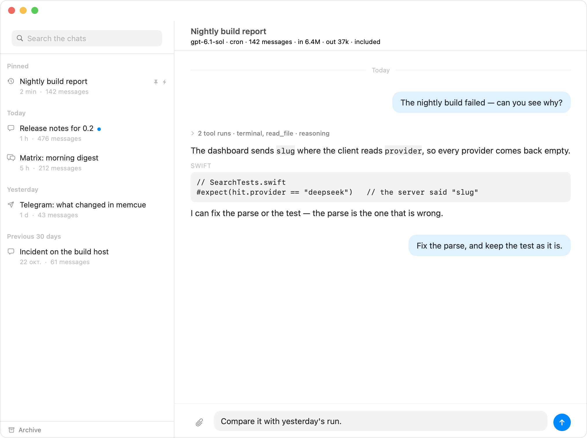
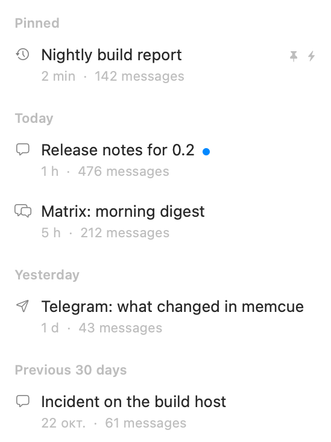
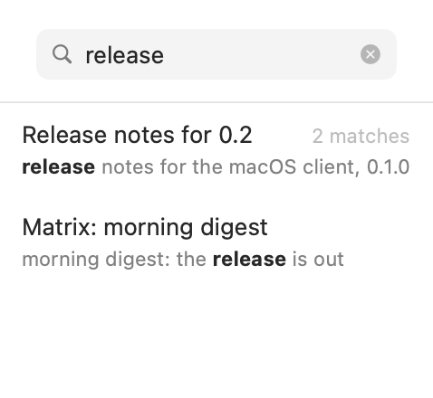
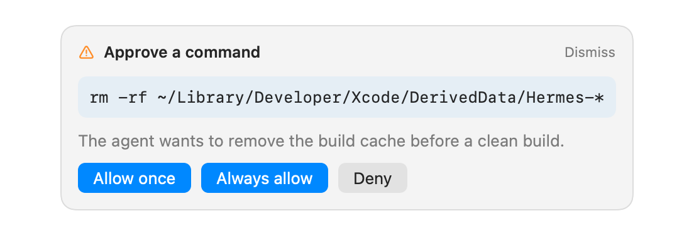
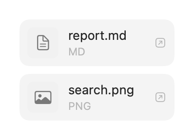
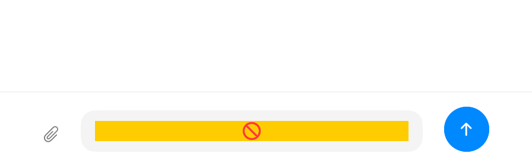
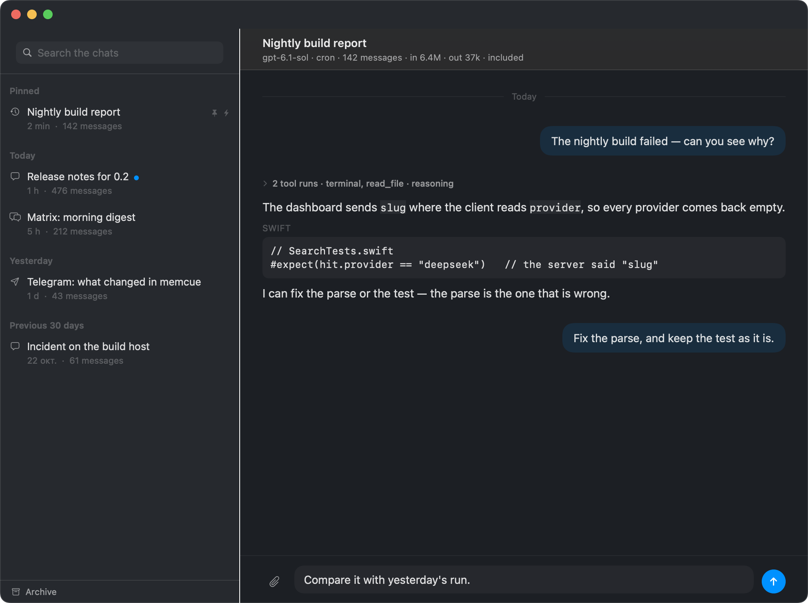

# Hermes for macOS

A native macOS client for the [Hermes Agent](https://github.com/NousResearch/hermes-agent) dashboard
(`hermes dashboard`) — the same server the [Android client](https://github.com/juev/hermes) talks to.

Swift 6 and SwiftUI. No Catalyst, no Electron, no web view: the protocol is spoken directly over the
dashboard's HTTP and its JSON-RPC socket.



## What it does

- **Sign-in** — the dashboard's `native_pkce` flow in the system browser, the code back on a loopback
  listener, the tokens in the Keychain. The next launch opens straight into the chats; when the tokens
  have run out the app says so instead of opening a browser by itself.
- **Chats** — the sidebar groups them the way a long list is read (pinned, today, yesterday, the last
  week and month, then by month and year), with the archive behind a button, a pinned search field, and
  rename, archive and delete on a right click.
- **Reading** — the answer is set for reading and Markdown is rendered rather than shown. What a turn
  did on the way — its thinking, its commands, its tool runs — folds into a single line that opens on a
  click, so the answer is what the eye lands on. Each day of a long chat opens with its own separator,
  the transcript follows a streaming answer until you scroll away, and a chat paints from disk before
  the dashboard answers.
- **Writing** — Return sends, Option+Return starts a new line, the paperclip attaches a picture or a
  file, ⌘N starts a chat at once, the toolbar picks the model the chat answers on, and an approval, a
  choice or a secret from the agent arrives as a card above the field with a banner behind it.
- **Files** — a file the agent delivers is drawn under the answer, a picture showing itself; a click
  fetches it with the token and opens it.
- **Notifications** — a banner when a turn ends out of sight, and `hermes-push` for turns that finish
  anywhere: Telegram, Matrix, a cron run. The dashboard posts an RFC 8291 Web Push body to an ntfy topic
  this Mac subscribes to with its own P-256 keys, and the app opens it itself.
- **Tailscale** — a dashboard published only on the tailnet is told apart from one that is down: the
  address family is read before a request is made, and the answer names Tailscale instead of waiting
  out a timeout. MagicDNS names and `100.64.0.0/10` addresses both work.
- **One settings window** — the dashboard's address and the notifications, behind one gear (⌘,).

## Screenshots

| | |
| --- | --- |
|  |  |
| The chat list, grouped by date, pinned chats first. | Search over the dashboard's index: one row per chat. |
|  |  |
| A command the agent stops before running. | A file the agent delivered, opened with one click. |
|  |  |
| The composer, with a file attached. | The same window in the dark. |

Every picture is drawn by a test from synthetic data — no address, no chat and no name of a real
dashboard (`HERMES_DOC_SCREENSHOTS=1 swift test --package-path Core --filter DocScreenshots`).

## Requirements

- macOS 15 or later.
- To build: Xcode 27 with the macOS 27 SDK, and XcodeGen (`brew install xcodegen`).

## Install

A release is a disk image in [Releases](../../releases). It is **not notarized**: the build of this
draft is signed ad-hoc, so the first launch needs System Settings → Privacy & Security → *Open Anyway*,
or

```sh
xattr -dr com.apple.quarantine /Applications/Hermes.app
```

To build it yourself instead:

```sh
scripts/build.sh        # build/Build/Products/Debug/Hermes.app
```

## Two clients, one server

The clients live in separate repositories and share no source: the Android app is Kotlin and Compose on
Android APIs, this one is Swift and SwiftUI on macOS. What they share is what the server sends and
expects, and that is written down once, in the Android repository:
[docs/protocol.md](https://github.com/juev/hermes/blob/main/docs/protocol.md).

A behaviour learned from the server is described there, in the same piece of work that relies on it, and
not copied into this README.

## Layout

- `Core/` — a Swift package with everything that has nothing to do with a window.
  - `HermesCore` — the routes and frames of the contract, the sign-in, the socket and its reconnects,
    the transcript and its formatting, the push keys and their decryption, the on-disk cache.
  - `HermesUI` — the typography and the views: the transcript, the composer, the question card, the
    search results. SwiftUI only, so a test can draw it with `ImageRenderer`.
  - `hermes-live` — an executable that runs the client's own code against a live dashboard.
- `App/` — the window: the connection, the chat model, notifications, the Keychain.
- `project.yml` — the XcodeGen description. `Hermes.xcodeproj` is generated from it and not committed.

## Checking

```sh
scripts/test.sh         # swift test on the package: no window, no Xcode project
scripts/build.sh        # the app itself
scripts/smoke.sh        # the client's own code against a live dashboard, tokens from the Keychain
```

`scripts/smoke.sh` prints what came back — the status, the chats, the archive, the search, a transcript
folded from stored rows, a delivered file when there is one, the ticket and `gateway.ready`, and a join
that turns a stored id into a live one. It is the way to see the client work without opening a window.

The typography is checked by rendering the views with `ImageRenderer` into `build/snapshots/`, and the
pictures above are rendered the same way from synthetic data.

## What is not there yet

- A turn does not survive quitting the app; it does survive closing the window.
- Pinning is kept on this Mac, per dashboard, because a plain `hermes dashboard` has no call to store it.
- Attachments arrive as `MEDIA:` lines; a row that carries `image_url` content parts has not been seen in
  the installation this was written against.
- Managing Tailscale from inside the app — starting it, signing in, choosing an exit node — is not
  there: the app works over the tailnet and says so when the tailnet is not reachable.

## License

[MIT](LICENSE).
